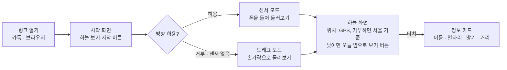

# 진짜 밤하늘 + 오로라 — PRD

2026-11-15 · 재원

> 원본: [Claude Docs PRD](https://claude.ai/artifact/RD1NFaQHPRLDkurrKnBkrR) · 구현 계획: [개발 계획 문서](https://claude.ai/artifact/64tFHDXA76UoZyB5o6N65v)

## 1. 개요

**한 줄 요약**: 카톡 링크 하나로 열면, 지금 내 위치에서 폰을 든 방향의 **실제 밤하늘**(별·별자리·달·행성)을 예쁘게 보여주는 웹 앱. 설치는 필요 없어.

**왜 만드나**: 공모전이나 과제가 아니라 그냥 해보고 싶어서 만드는 개인 프로젝트야. 친구들이 폰으로 바로 열어보고 "오, 진짜 저기 있네" 하는 게 목표고, Claude Code + Fable 5.2로 긴 개발 작업을 끝까지 해보는 것도 목적이야.

**핵심 원칙 3가지**

1. **진짜일 것**: 위치·시간이 틀린 예쁜 하늘보다 맞는 하늘이 먼저야. 오로라처럼 실제가 아닌 연출은 상상 모드라고 분명히 표시해.
2. **링크 하나로 끝날 것**: 설치·로그인·설명서 없이 첫 화면에서 버튼 하나만 누르면 돼야 해.
3. **안 되면 조용히 대체할 것**: 센서·위치·성능 문제가 생겨도 흰 화면이나 오류 대신 드래그 모드·기본 위치로 계속 보여줘.

**이 문서의 역할**: 이 PRD는 *무엇을, 왜, 어느 수준까지* 만드는지 정해. *어떻게, 어떤 순서로* 만드는지(기술 스택, 폴더, 단계별 프롬프트)는 개발 계획 문서에 있어. 두 문서가 다르면 PRD를 기준으로 계획을 고치면 돼.

**가제목**: "진짜 밤하늘". 앱 이름은 아직 정하지 않았어 (10장 미해결 질문).

## 2. 목표와 비목표

### 목표

| # | 목표 | 어떻게 알 수 있나 |
| --- | --- | --- |
| G1 | 폰을 든 방향의 하늘이 실제와 맞음 | 밤에 달·밝은 행성을 비춰서 앱 속 위치와 비교, 자동 정확도 테스트 통과 |
| G2 | 링크를 열고 버튼 하나로 하늘이 보임 | 처음 보는 친구가 설명 없이 하늘까지 도달 |
| G3 | 예뻐서 친구에게 다시 보여주고 싶음 | 은하수·반짝임·별똥별·오로라가 자연스럽고 과하지 않음 |
| G4 | 친구 폰에서도 부드럽고 안 멈춤 | 친구 2~3명 폰에서 끊김 없이 동작 |
| G5 | 앱을 열지 않아도 링크가 눈에 띔 | 카톡에 사진·제목 미리보기 카드 |

### 비목표 (이번엔 안 함)

- **천문 교육용 정밀 도구**: 망원경 조작, 정밀 좌표 표시, 딥스카이 천체 목록은 넣지 않아. 눈으로 보는 하늘까지만.
- **실제 오로라 예보**: 오로라는 상상 모드일 뿐, 우주 날씨 데이터는 연동하지 않아.
- **회원·서버·기록 저장**: 로그인, 댓글, 관측 일지 같은 서버가 필요한 기능은 없어.
- **앱스토어 앱**: 웹 앱만. 홈 화면 추가(PWA)는 P1.
- **날씨·구름 반영**: "지금 구름 때문에 안 보여요"는 표시하지 않아.
- **수익화·통계 수집**: 광고·방문자 추적 도구 없음.

## 3. 사용자와 사용 장면

주 사용자는 **카톡으로 링크를 받은 친구**야. 천문학을 모르고, 아이폰이나 갤럭시로 카톡 안에서 바로 열고, 30초 안에 재미가 없으면 닫아.

| 사용자 | 상황 | 원하는 것 |
| --- | --- | --- |
| 친구 (주 사용자) | 카톡 링크를 누름, 대부분 낮이나 실내 | 바로 예쁜 밤하늘, "이거 진짜야?" 하는 놀라움 |
| 친구 (밤 야외) | 밤에 밖에서 하늘을 보며 | 저 밝은 게 무슨 별인지, 별자리가 어디인지 |
| 컴퓨터로 연 사람 | PC 카톡이나 브라우저 | 마우스로 둘러보기 |
| 나 (개발자) | 밤에 테스트하며 | 센서 값·FPS·오류 확인 (`?debug=1`) |

### 대표 장면 (시나리오)

1. **낮에 카톡으로 열기**: 친구가 점심시간에 링크를 열면 실제로는 파란 하늘이야. "오늘 밤으로 보기"를 누르면 오늘 밤 하늘로 바뀌고, 폰을 천장 쪽으로 들면 그 위치의 밤 하늘이 보여.
2. **밤에 밖에서 비춰보기**: 동쪽에 밝은 점이 있어서 폰을 들면 같은 자리에 "목성"이 보이고, 누르면 설명 카드가 떠. 조금 어긋나면 나침반 보정으로 맞춰.
3. **오로라 보여주기**: 내가 `?aurora=1` 링크를 보내면 친구는 북쪽 하늘에 물결치는 오로라를 보고, "한국에선 거의 볼 수 없는 상상 모드" 안내도 함께 봐.
4. **허용을 거부한 경우**: 위치나 방향 허용을 거부해도 서울 기준 하늘이 드래그 모드로 뜨고, 오류 화면은 없어.

## 4. 사용자 흐름

방향 허용을 하든 안 하든, 위치를 허용하든 안 하든 누구나 하늘 화면까지 가. 허용 여부는 둘러보는 방식(센서/드래그)과 기준 위치(내 위치/서울)만 바꿔.

## 5. 기능 요구사항 — P0 (v1.0 필수)

P0 19개가 모두 수용 기준을 통과해야 v1.0이야. "단계"는 개발 계획 문서의 단계 번호야.

### 하늘 (정확도)

| ID | 요구사항 | 수용 기준 | 단계 |
| --- | --- | --- | --- |
| F1 | 실제 별 표시 | 6.5등급까지 약 9,000개. 고도 5° 이상에서 Skyfield 기준값과 위치 차이 0.05° 이내(굴절 제외) | 1·2 |
| F2 | 별 밝기·색 | 밝을수록 크고 또렷함, 색지수에 따라 푸른빛~붉은빛. 시리우스가 가장 밝은 항성 | 2 |
| F3 | 달·행성·해 | 달 위치 0.1°, 행성·해 0.05° 이내. 달 빛난 비율 1%p 이내, 밝은 쪽이 해를 향함. 수성~토성 한글 이름 | 4 |
| F4 | 시간에 따른 하늘색 | 해 고도로 낮·박명 3단계·밤이 부드럽게 이어짐. 해가 -6°보다 높으면 "오늘 밤으로 보기" 버튼, 누르면 천문박명 끝 시각으로 이동 | 4 |
| F5 | 별자리 선·이름 | 88개 별자리 전부 선 + 한글 이름. 선의 꼭짓점마다 실제 별이 0.2° 안에 있음. 이름이 겹치지 않음 | 3 |

### 조작

| ID | 요구사항 | 수용 기준 | 단계 |
| --- | --- | --- | --- |
| F6 | 별 터치 정보 카드 | 손가락 크기(약 44px) 안의 가장 가까운 별, 비슷하면 밝은 별 우선. 카드에 한글 이름·별자리·밝기(쉬운 말)·거리(광년). 달·행성도 터치 가능 | 3·4 |
| F7 | 시작 화면과 허용 | 버튼 하나("하늘 보기 시작")로 방향·위치 허용을 차례로 요청. 위치는 저장되지 않는다는 안내 한 줄 | 5 |
| F8 | 폰 방향 따라가기 | 보정 전에도 실제 달·행성과 대략 10° 안쪽. 가만히 들면 떨리지 않음. 천정 쪽으로 들어도 화면이 빙빙 돌지 않음 | 5 |
| F9 | 나침반 보정 | 센서 모드에서 좌우 드래그로 방위 맞추기, 다음에 열어도 유지 | 5 |
| F10 | 드래그·확대 | 마우스·터치 드래그 회전, 휠·핀치 확대(시야각 20~100°). 센서/드래그 전환 버튼 | 2·5 |
| F11 | 위치 | GPS 허용 시 내 위치. 거부·실패 시 서울 기준 + 도시 선택(국내 10곳) | 5 |

### 연출

| ID | 요구사항 | 수용 기준 | 단계 |
| --- | --- | --- | --- |
| F12 | 은하수 | 실제 위치(데네브·알타이르·궁수자리 쪽이 밝고 북두칠성 쪽은 어두움). 하늘이 밝거나 달이 밝으면 약해짐 | 6 |
| F13 | 반짝임·지평선 빛 | 지평선 가까울수록 반짝임이 강하고 별이 어둡고 붉어짐. 모션 줄이기 설정이면 약하게 | 6 |
| F14 | 별똥별 | 평균 수십 초에 한 번, 고도 20° 이상. 끌 수 있음 | 7 |
| F15 | 오로라 꿈 모드 | 기본값 꺼짐. 켜면 북쪽 낮은 하늘에 커튼 + "한국에선 거의 볼 수 없는 상상 모드" 표시 | 7 |

### 설정·공유·안정성

| ID | 요구사항 | 수용 기준 | 단계 |
| --- | --- | --- | --- |
| F16 | 설정 패널 | 별자리 선·이름·은하수·반짝임·별똥별·오로라·센서/드래그. 한 손으로 닿는 화면 아래쪽, 새로고침 후 유지 | 7 |
| F17 | URL 파라미터 | t, lat, lon, az, alt, fov, aurora, seed, debug로 시간·장소·시점·설정 고정. 같은 URL이면 같은 화면 | 2·7 |
| F18 | 공유와 출처 | 카톡 미리보기 카드(사진·제목·설명). ⓘ 화면에 데이터·라이브러리 출처 전부 | 9 |
| F19 | 대체 동작과 디버그 | WebGL 미지원·데이터 실패·센서 실패 모두 안내 화면이나 드래그 모드로, 흰 화면 없음. `?debug=1`에 센서 값·FPS·최근 오류 | 5·8 |

## 6. 기능 요구사항 — P1 (있으면 좋음)

P1은 v1.0을 낸 뒤 친구들 반응을 보고 골라. 순서는 내가 생각한 "재미 대비 난이도" 순이야(추론).

| ID | 기능 | 한 줄 설명 | 난이도 |
| --- | --- | --- | --- |
| P1-1 | 시간 슬라이더 | 오늘 밤 하늘이 도는 모습을 빨리 돌려보기 | 낮음 |
| P1-2 | 유성우 날짜 반영 | 쌍둥이자리 유성우 같은 날엔 그 방향에서 별똥별이 더 자주 | 낮음 |
| P1-3 | 검색과 방향 안내 | "목성"을 치면 화면 가장자리에 그쪽 화살표 | 중간 |
| P1-4 | 도시 / 시골 하늘 | 빛공해에 따라 보이는 별 개수 조절 | 중간 |
| P1-5 | 화면 사진 저장·공유 | 지금 보는 하늘을 이미지로 | 중간 |
| P1-6 | 별·별자리 이야기 | 정보 카드에 짧은 설명 한두 줄 | 중간 (내용 작성이 일) |
| P1-7 | 홈 화면에 추가 (PWA) | 앱 아이콘으로 열기, 오프라인에서도 동작 | 중간 |
| P1-8 | 더 많은 별 | 8등급까지 늘리기 (성능 보고 결정) | 중간 |
| P1-9 | 영어 표시 | 외국인 친구용 언어 전환 | 중간 |
| P1-10 | 카메라 배경 (AR) | 실제 카메라 화면 위에 별 겹치기 | 높음 (권한·정렬 문제) |

## 7. 비기능 요구사항

숫자로 된 기준은 모두 내가 정한 목표값이야(추론). 실제 폰에서 해보고 너무 빡빡하거나 느슨하면 조정해도 돼.

| 구분 | 요구사항 | 확인 방법 |
| --- | --- | --- |
| 정확도 | 별·행성·해 0.05°, 달 0.1° 이내 (Skyfield 기준, 5개 장소 × 6개 시각). 화면은 굴절 보정 켬 | 자동 테스트 + Stellarium 눈 비교 |
| 정확도 우선 | 연출을 더해도 정확도 테스트는 항상 통과 | CI가 매번 검사 |
| 성능 | 아이폰에서 60fps 목표, 느리면 자동으로 화질 낮춤 | 디버그 패널 FPS |
| 로딩 | 첫 화면에 별이 뜨기까지 다운로드 1MB 이하, 전체 3MB 이하. 은하수는 나중에 불러옴 | CI 파일 크기 검사 |
| 배터리 | 탭을 숨기면 그리기 멈춤, 가만히 있을 땐 프레임 수 낮춤 | e2e + 직접 확인 |
| 개인정보 | 서버 없음. 위치는 폰 안에서 계산에만 쓰고 어디에도 보내거나 저장하지 않음. 방문자 추적 도구 없음. 기기에 저장하는 건 설정과 나침반 보정값뿐 | 코드 리뷰 |
| 보안 연결 | https에서만 서비스 (센서·GPS에 필수) | GitHub Pages 기본 제공 |
| 접근성 | 모션 줄이기 설정 존중, 버튼은 손가락 크기 이상, 글자는 어두운 배경에서 잘 읽히는 대비 | 직접 확인 |
| 화면 | 아이폰 노치·홈바 영역에 버튼이 가려지지 않음. 세로 화면 기준, 가로도 깨지지 않음 | 모바일 크기 스크린샷 |
| 언어 | 화면 문구는 한국어, 천문 용어는 쉬운 말로 (예: "2.3등급" 대신 "도시에서도 보임") | 직접 확인 |
| 정직함 | 실제가 아닌 연출(오로라)은 화면에 상상 모드라고 표시 | e2e |
| 라이선스 | HYG(CC BY-SA 4.0), Gaia 이미지(CC BY-SA 3.0 IGO)는 출처 표기 + 가공본도 같은 라이선스. d3-celestial(BSD)·astronomy-engine(MIT)·Three.js(MIT) 문구 유지. GPL 코드·데이터는 사용하지 않음 | ATTRIBUTION.md, ⓘ 화면 |

## 8. 지원 환경

아이폰은 브라우저 3개(사파리·크롬·카톡)를 다 직접 확인해야 해. 아이폰 브라우저는 전부 사파리 엔진(WebKit)을 쓰지만, 카톡 안에서의 권한 동작은 확인되지 않았기 때문이야.

| 환경 | 지원 수준 | 센서 모드 | 확인 방법 |
| --- | --- | --- | --- |
| 아이폰 사파리 | 1급 (반드시 완벽) | 허용 버튼 후 사용 | 내 아이폰, 매 단계 |
| 아이폰 카톡 인앱 브라우저 | 1급 | 모름. 안 되면 드래그 + "다른 브라우저로 열기" 안내 | 내 아이폰, 0단계부터 |
| 아이폰 크롬 | 1급 | 사파리와 같을 것으로 추론 (같은 엔진) | 내 아이폰, 5단계부터 |
| Windows 크롬 (컴퓨터) | 1급 | 없음, 마우스 드래그 | 개발할 때 상시, Playwright |
| 안드로이드 크롬·카톡 | 2급 (크게 깨지지 않음) | 허용 없이 동작할 가능성 높음 (추론) | 친구 폰, 8단계 |
| 삼성 인터넷, Mac 사파리, 엣지 | 3급 (열리면 됨) | — | 기회 있을 때 |
| 아이패드 | 3급 | 아이폰과 같은 방식 | 네 아이패드로 한 번 |

**안 되는 환경의 최소 동작**: 3D(WebGL)를 못 켜는 브라우저에서도 안내 화면은 떠야 해. 최소 iOS 버전은 아직 정하지 않았어. 친구들 폰을 확인한 뒤 정하면 돼.

## 9. 성공 기준

통계 도구는 안 넣기로 했으니까, 성공은 자동 테스트 결과와 친구들에게 직접 받은 반응으로 판단해. 아래 숫자는 내가 제안하는 기준이야(추론).

**v1.0 출시 조건** (전부 충족해야 친구들에게 공유)

- [ ] P0 19개 수용 기준 통과, `npm run check` 초록불
- [ ] 내가 밤에 밖에서 달과 밝은 행성 1개 이상을 비춰봤을 때 보정 후 거의 일치
- [ ] Stellarium과 비교한 3개 장면에서 별자리 모양·위치가 같아 보임
- [ ] 아이폰 사파리·크롬·카톡에서 흰 화면이나 멈춤 없음
- [ ] 카톡 미리보기 카드가 뜸

**공유 후 확인할 것** (친구 5명 이상에게 보낸 뒤)

| 기준 | 목표 | 확인 방법 |
| --- | --- | --- |
| 혼자서 하늘까지 도달 | 설명을 더 해줘야 한 친구가 없음 | "어떻게 해?"라는 질문을 받았는지 |
| 진짜라고 느낌 | 절반 이상이 "진짜 그 자리에 있다"고 느낌 | 친구들에게 짧게 물어보기 |
| 다시 열어봄 | 1명 이상이 밤에 다시 열거나 다른 사람에게 보냄 | 친구들 말, 다른 데서 링크를 봤다는 연락 |
| 오류 제보 | 없거나, 받은 건 1주 안에 고침 | 친구가 보낸 화면 캡처 + `?debug=1` |

**나에게의 성공**: Claude Code + Fable 5.2로 0~9단계를 끝까지 완주하고, 단계마다 PROGRESS.md에 기록이 남아 있음.

## 10. 리스크, 의존성, 미해결 질문

### 리스크

| 리스크 | 영향 | 대응 |
| --- | --- | --- |
| 폰 나침반 오차가 커서 "진짜" 느낌이 깨짐 | 큼 (G1) | 부드러운 추적 + 나침반 보정(F9) + 디버그 패널로 원인 파악 |
| 카톡 인앱 브라우저에서 센서·위치가 막힘 | 큼 (친구 대부분이 카톡으로 엶) | 0단계부터 확인, 드래그 모드로 대체 + "다른 브라우저로 열기" 안내 |
| 오래된 폰에서 느리거나 뜨거워짐 | 중간 (G4) | 자동 화질 조절, 후처리 미사용 |
| 연출을 더하다 정확도가 깨짐 | 중간 (G1) | 정확도 테스트를 CI에서 매번 실행 |
| 낮에 열어서 실망하고 닫음 | 중간 (G2) | "오늘 밤으로 보기" 버튼(F4) |
| 긴 개발 중 Fable이 범위를 넘거나 규칙을 잊음 | 중간 | CLAUDE.md + PROGRESS.md, 단계별 새 대화 |

### 의존성

- **데이터**: HYG v4.2 별 목록, d3-celestial 별자리 선, ESA Gaia 은하수 이미지, 한국어 별자리 이름 목록
- **라이브러리**: Three.js, astronomy-engine (테스트용: Skyfield, Vitest, Playwright)
- **서비스**: GitHub(계정 pkjewon, 공개 저장소), GitHub Pages, GitHub Actions
- **기기**: 내 아이폰(실기 테스트), Windows 노트북(개발), 친구 폰 2~3대(8단계)

### 미해결 질문

| 질문 | 언제까지 | 누가 정함 |
| --- | --- | --- |
| 앱 이름은? (지금은 가제목 "진짜 밤하늘", 저장소는 night-sky) | 9단계 전 | 나 |
| 낮에 열었을 때 기본 화면을 진짜 낮 하늘로 할지, 바로 오늘 밤 하늘로 할지 | 4단계 | 나 |
| 아이폰 나침반 값(webkitCompassHeading)이 자기 북쪽 기준인지 진짜 북쪽 기준인지 | 5단계 | 밤에 실측해서 확인 |
| 카톡 인앱 브라우저에서 센서·위치 허용이 되는지 | 0단계 | 내 아이폰으로 확인 |
| 한국어 별자리 이름의 기준 출처와 사용 조건 | 3단계 | Fable이 찾고 내가 확인 |
| 최소 지원 iOS 버전 | 8단계 | 친구 폰 확인 후 |
| P1 중 무엇부터 할지 | v1.0 공유 후 | 친구 반응 보고 |

## 11. 릴리스 계획

기한은 없고, 마일스톤마다 "통과 조건"을 만족해야 다음으로 넘어가. 친구들에게는 M4(v1.0)에서 처음 공개하고, 그 전엔 나 혼자 배포 주소로 확인해.

| 마일스톤 | 개발 단계 | 포함 요구사항 | 통과 조건 |
| --- | --- | --- | --- |
| M1 맞는 하늘 | 0~4 | F1~F6, F10(드래그), F17 | 정확도 테스트 통과, Stellarium과 눈 비교 일치 |
| M2 폰으로 보는 하늘 | 5 | F7~F11, F19(디버그) | 밤에 아이폰으로 달·행성이 대략 10° 안, 허용 거부 시에도 동작 |
| M3 예쁜 하늘 | 6~7 | F12~F16 | 기존 테스트 전부 통과, 아이폰 60fps 근처, 디자인 피드백 반영 |
| M4 v1.0 공개 | 8~9 | F18, F19(안정성) + 비기능 요구사항 | 9장 "v1.0 출시 조건" 전부 충족 → 친구들에게 공유 |
| v1.x | — | P1 중 골라서 | 친구 반응으로 우선순위 결정 |

구현 방법과 단계별 Claude Code 프롬프트는 개발 계획 문서에 있어.
