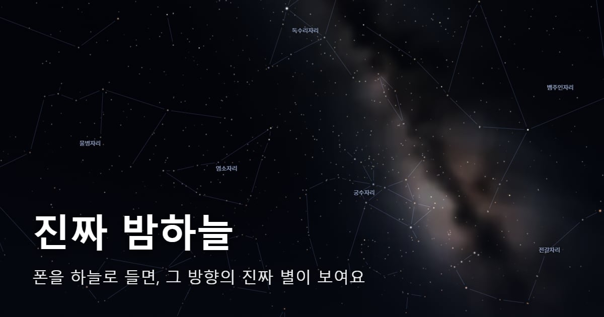

# 진짜 밤하늘

폰을 하늘로 들면, 지금 그 방향에 있는 **진짜 별·별자리·달·행성**이 보이는 웹 앱. 설치 없이 링크만 열면 돼요.

**👉 https://pkjewon.github.io/night-sky/**



## 쓰는 법

1. 링크를 열고 **하늘 보기 시작** → 방향·위치 허용 (거부해도 서울 기준으로 볼 수 있어요)
2. 폰을 하늘로 들면 그 방향의 별이 보여요. 컴퓨터에서는 마우스로 끌어서 둘러보고 휠로 확대해요
3. 별·행성·달을 누르면 이름과 설명 카드
4. 낮이라면 **오늘 밤으로 보기**
5. 설정에서 별자리 선·이름·은하수·반짝임·별똥별을 켜고 끌 수 있고, **오로라 꿈 모드**(한국에선 거의 볼 수 없는 상상 모드)도 있어요
6. 방향이 어긋나 보이면 폰 방향 모드에서 좌우로 끌어서 나침반을 맞춰요

### 링크로 장면 고정하기

| 파라미터 | 예 | 뜻 |
| --- | --- | --- |
| `t` | `2026-12-14T22:00+09:00` | 시각 (`+`는 `%2B`로) |
| `lat`, `lon` | `37.76`, `126.78` | 위치 |
| `az`, `alt`, `fov` | `180`, `30`, `70` | 보는 방향(북=0°, 동=90°)·높이·시야각 |
| `aurora` | `1` | 오로라 꿈 모드 켜고 열기 |
| `seed` | `7` | 별똥별 등 연출을 고정한 한 장면 |
| `debug` | `1` / `table` | 디버그 패널 / 천체 위치 표 |

예: [쌍둥이자리 유성우 무렵 겨울밤](https://pkjewon.github.io/night-sky/?t=2026-12-14T22:00%2B09:00&az=125&alt=30)

## 정확도

별·해·달·행성 위치를 Skyfield(JPL DE421)와 비교해 최대 오차 0.006° (보름달 지름의 1/80). 자세한 표는 [docs/ACCURACY.md](docs/ACCURACY.md).

## 개발

```bash
npm install
npm run dev      # 개발 서버
npm run check    # 타입 검사 + 단위 테스트 + 빌드 + 크기 검사 + 화면 테스트
```

Vite + TypeScript + Three.js(직접 쓴 셰이더) + astronomy-engine. 테스트는 Vitest·Playwright.
규칙은 [CLAUDE.md](CLAUDE.md), 계획은 [docs/PLAN.md](docs/PLAN.md), 진행 기록은 [docs/PROGRESS.md](docs/PROGRESS.md).

## 라이선스

- 코드: [MIT](LICENSE)
- 별 데이터(`public/data/`): HYG Database v4.2 가공본, **CC BY-SA 4.0** · 별자리 선은 d3-celestial(BSD-3-Clause) — [public/data/LICENSE](public/data/LICENSE)
- 은하수 그림(`public/textures/`): ESA/Gaia/DPAC 가공본, **CC BY-SA 3.0 IGO** — [public/textures/LICENSE](public/textures/LICENSE)
- 전체 출처: [ATTRIBUTION.md](ATTRIBUTION.md)

위치는 기기 안에서 계산에만 쓰이고 어디에도 보내거나 저장하지 않아요. 서버도 방문자 추적도 없어요.
